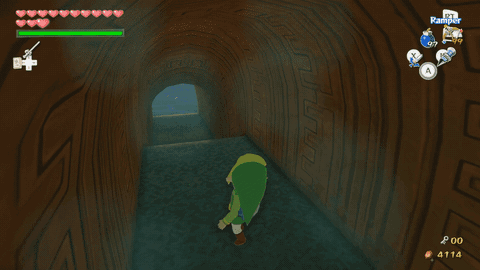
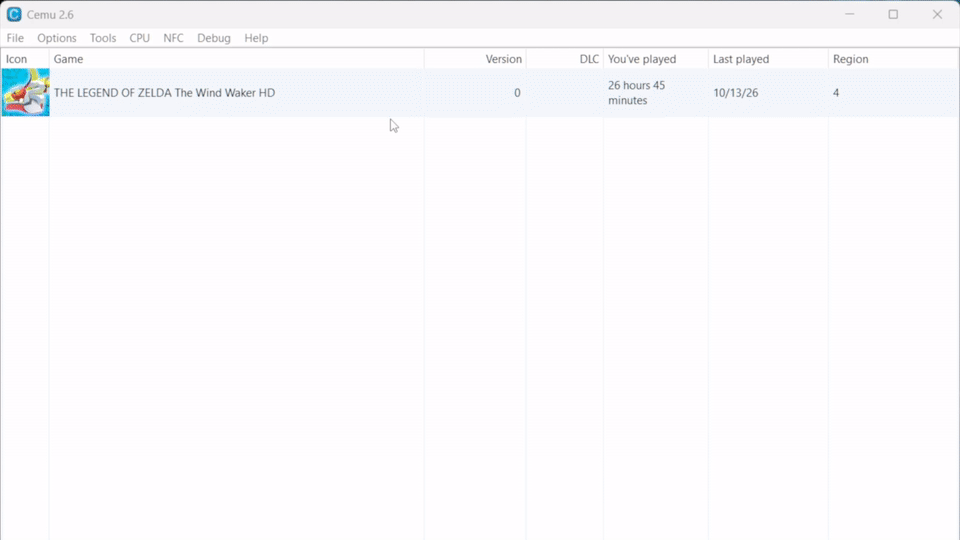

# The Wind Waker HD — Minimap HD

A Cemu graphic pack that displays Wind Waker HD's existing island, dungeon and treasure-chart resources on the main game screen, using resources from the installed game alongside project-created interface elements.

[Watch the full showcase on YouTube](https://youtu.be/mgaJ7TTNPg0)

**Version 1.3** | **European and American v0** | **Tested with Cemu 2.6** | **MIT license**

Minimap HD 1.3 includes US support, controlled-companion tracking, airborne dungeon floors and smoother map transitions. See the [changes since 1.2.1](CHANGELOG.md) and [validation record](docs/validation-1.3.md).

## Features

- Island and dungeon minimaps on the TV screen, with compact and expanded views.
- Automatic tracking of the controlled character's dungeon floor: Link, Medli or Makar, including airborne movement.
- Camera-oriented companion tracking and vertical floor transitions, with view preferences preserved when returning to Link.
- A parchment frame, an optional black background, and configurable opacity and movement fading.
- An animated wind direction arrow on island maps.
- A sailing view with a treasure chart beside the minimap, chart cycling, and selection synchronized with the GamePad.
- Native discovery requirements and dungeon marker rules, including the Map and Compass items and opened chests.
- HUD visibility integrated with menus, first-person views, cutscenes, and loading transitions.

## Download and install

The [Minimap HD 1.3 installation ZIP](dist/WindWakerHD_MinimapHD-1.3.zip) contains both regional patches and English documentation. Its [SHA-256 checksum](dist/WindWakerHD_MinimapHD-1.3.zip.sha256) is available separately. The optional Xbox graphics pack is not included or required.

1. Close Cemu.
2. Extract the ZIP and copy `WindWakerHD_MinimapHD` into Cemu's active `graphicPacks` directory. A portable installation normally uses `portable/graphicPacks`.
3. Open **Options → Graphic packs**, select **The Legend of Zelda: The Wind Waker HD**, and enable **Mods → Minimap HD**.
4. Select the desired settings and launch the game. Setting changes require a game restart.

For upgrades, move the previous pack folder outside `graphicPacks` before installing. Keep only one active copy. Earlier folders may be named `WindWakerHD_NativeLocalMap` or `WWHD_NativeLocalMap`.

The pack requires no external script or emulator modification. Original game files are not replaced. Controller profiles, saves, and emulator settings are not included.

See the [installation guide](docs/installation.md) for source-archive installation, troubleshooting, and removal.

## Compatibility

| Requirement | Supported configuration |
| --- | --- |
| Game | The Legend of Zelda: The Wind Waker HD |
| Region and revision | European v0 and American v0 |
| EU title / executable module | `0005000010143600` / `B7E748DE` |
| US title / executable module | `0005000010143500` / `475BD29F` |
| Current gameplay validation | EU/US results and source scopes documented in the validation record |
| Emulator tested | Cemu 2.6 |
| Graphic pack rules format | Version 6 |
| Game language | Preserved from the installed game |

Regional assembly and focused checks passed, and the requested US scenario campaign was completed. EU coverage combines the earlier full campaign with targeted checks for the later companion features. Other regions, executable revisions, and emulator versions have not been validated. Mods that replace the same HUD layouts may conflict. The optional Xbox/GameCube HUD pack is separate and is not required by Minimap HD.

## Native map behaviour and availability

Minimap HD follows Wind Waker HD's native map availability, map type and marker visibility rules. Controlled-character tracking and in-flight floor selection are additional minimap features; the original map menu keeps its native floor policy. The on-screen controls, compact and expanded views, frame and fading are additions provided by the pack. Map-type switching also works with a Pro Controller without opening the Maps tab.

| Game context | Minimap behaviour |
| --- | --- |
| Discovered island, within local map coverage | The island map can be displayed |
| Undiscovered island or sector | Map artwork stays unavailable; a faded map shortcut with a question mark indicates the undiscovered area within local coverage |
| Outside local island-map coverage | No island plan is displayed on foot, while swimming or aboard; the sailing display returns to the compasses and hides the availability shortcut and treasure chart |
| Dungeon without the Map item | No dungeon minimap or custom map shortcuts are displayed |
| Dungeon with the Map item | The plan follows the controlled character's floor, including height-based updates during flight |
| Dungeon without the Compass item | Compass-dependent markers remain hidden according to the native game rules |
| Dungeon with the Compass item | Eligible markers follow native visibility, floor and opened-chest rules |
| Context without an available native map | No minimap is displayed |
| Menus, first-person views, cutscenes and loading | Native interface visibility takes priority over the minimap |

Companion markers, including Medli and Makar, follow their native position, orientation and visibility, including when they are carried or put down. The wind direction indicator is restricted to island maps.

Map availability is separate from the player's visibility controls for the current map view. While sailing, a view temporarily suspended outside local coverage is restored when coverage becomes valid, including its treasure chart; a deliberately selected compass view remains selected.

The native game state also governs special locations: Forsaken Fortress follows island/dungeon transitions when boarding, disembarking or swimming, while the Tower of the Gods retains a dungeon map aboard.

## Controls

Controls refer to emulated Wii U inputs; physical controller labels depend on Cemu's mapping.

| Context | Input | Action |
| --- | --- | --- |
| On foot | D-pad left | Show or hide the minimap |
| On foot | D-pad right | Switch between compact and expanded size while the minimap is visible |
| Dungeon map on foot | D-pad down | Toggle the native map zoom and camera-relative rotation |
| Aboard with a dungeon map | D-pad down | Cycle compact, expanded and hidden dungeon views |
| Aboard with a visible dungeon map | Left stick click (L3) | Toggle orientation and camera-relative zoom |
| Sailing with a marine map | D-pad down | Cycle between compasses, minimap, and minimap with a treasure chart |
| Sailing treasure-chart view | Left stick click (L3) | Cycle through eligible owned charts |

When the game selects a dungeon map aboard the boat, as in the Tower of the Gods, D-pad left/right retain the native cannon/crane controls. Dungeon visibility, size and orientation are shared across foot, swimming and boat contexts. The native map type selects the artwork; boat state selects the appropriate shortcuts.

In the marine sailing view, maps stay compact and treasure charts never appear alone. Local map coverage and discovery are required. A view temporarily suspended outside coverage returns when coverage becomes valid; a compass view deliberately selected by the player remains selected.

Chart selection does not identify or match the current island automatically. Link and boat markers are never added to the treasure chart. Broad overview charts are excluded; Triforce charts must be deciphered.

## Settings

| Setting | Default | Purpose |
| --- | --- | --- |
| Overall opacity | 100% | Opacity of the complete minimap block |
| Faded opacity | 70% | Opacity during movement or camera input |
| Fade on movement (Link + camera) | On | Enable movement and camera fading |
| Black background | On | Show the background behind the map |
| Background opacity (idle) | 40% | Set the background's resting opacity |
| Wind direction arrow | On | Show the animated arrow on island maps |

The parchment frame is always shown with a visible map. See [configuration](docs/configuration.md) for fading behavior and opacity examples.

## Artwork and credits

Project development and visual direction: **Chironeyes**, with coding and artwork assistance from **GPT-6 Astra**.

The pack combines project-created UI artwork with resources already present in the game. Map artwork, character markers, the dungeon compass, title ribbons, and fonts are native resources. The wind outline is redrawn from the native silhouette and uses the game's wind direction and animation resources.

A detailed [asset provenance record](docs/asset-provenance.md) distinguishes original additions, adaptations, and native resources. Original game textures are not redistributed as standalone assets in this repository.

## Changes and support

Version 1.3 adds US v0 support, controlled-companion and airborne floor tracking, remembered views, dungeon boat controls and refined transitions. The [changelog](CHANGELOG.md) records the changes since 1.2.1. The [validation record](docs/validation-1.3.md) separates manual results, synthetic checks and source-specific limits; the existing ending protection remains in place.

Bug reports can be filed in the [issue tracker](https://github.com/Chironeyes/The.Wind.Waker.HD-Minimap.HD/issues). Include the pack and Cemu versions, game region and revision, controller mode, active graphic packs, location, and reproduction steps. Screenshots of the TV and GamePad views are useful for map synchronization issues.

## Repository contents

- `graphicPacks/WindWakerHD_MinimapHD/`: installable Cemu pack and its PowerPC assembly patch.
- `assets/`: SVG sources for project-created artwork and the redrawn wind outline.
- `docs/`: installation, configuration, asset provenance, transition cases and development validation.
- `dist/`: released installation ZIPs and checksums, including 1.3 with EU/US support.
- `tools/package.py`: packages the existing pack using Python 3's standard library.

The assembly includes generated texture data. Editing an SVG source alone does not update the installed pack; the packaging tool does not compile artwork or rebuild the internal layout pipeline.

## License

Original project contributions are available under the [MIT license](LICENSE). Nintendo's original game resources and designs remain the property of their respective rights holders and are not relicensed by this project. See [NOTICE](NOTICE.md) and the asset provenance record.
